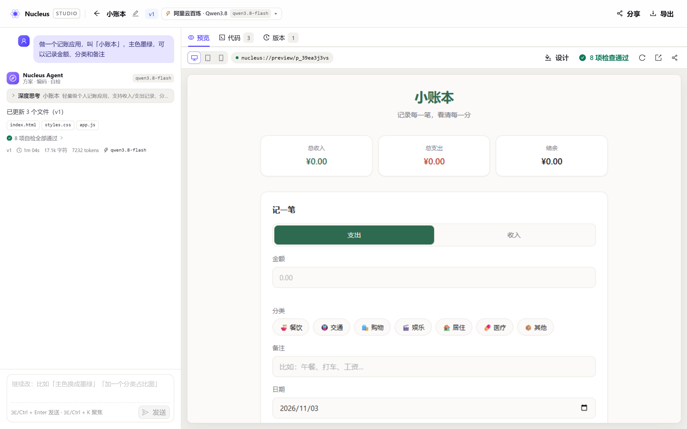
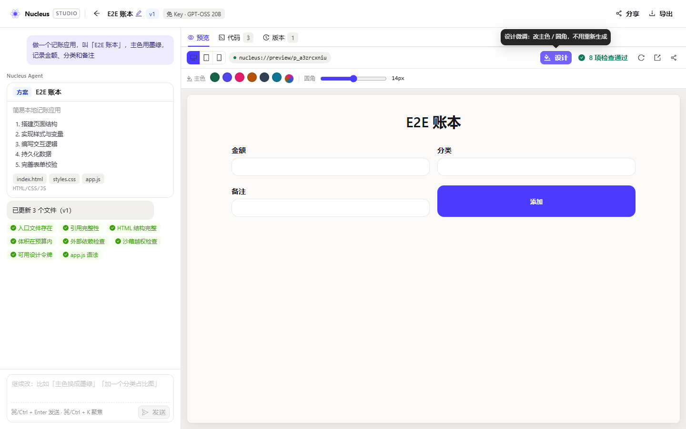
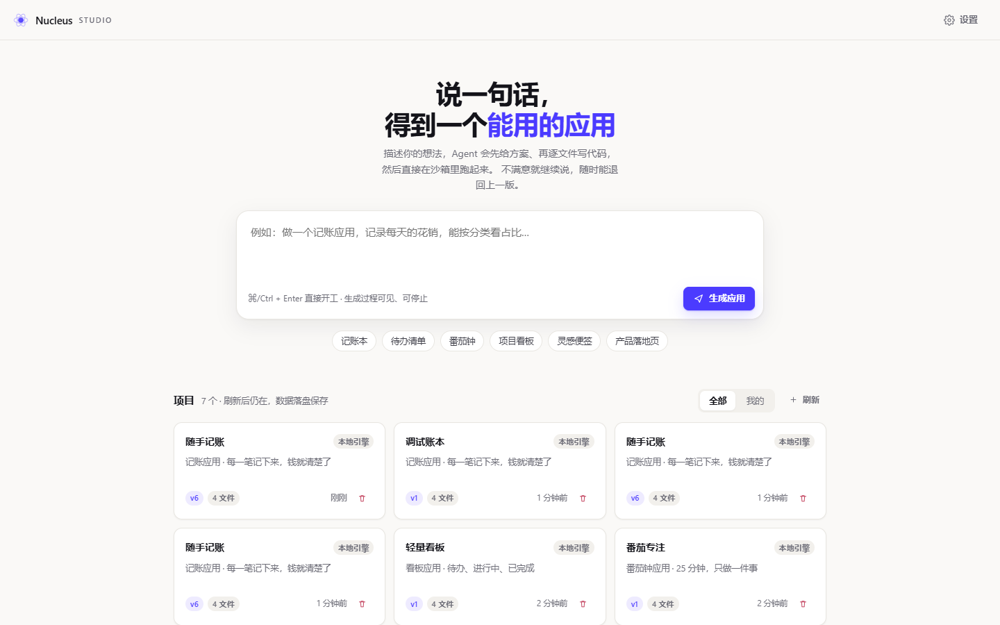

# Nucleus · 用一句话生成可运行的网页应用

> ROOT AI Native 全栈工程师笔试 · **Atoms-Demo** 实现
> 说一段需求 → Agent 实时流式产出代码 → 右侧立刻能点、能存、能改、能带走。

**在线体验**：<https://nucleus-studio.app.workbuddy.host/?sharecode=XLMO6EYD5C>（免注册，打开即用；链接需带 `sharecode` 参数）
**源代码**：<https://github.com/OPQ741/manus-agent>（public）

Nucleus 不是一个套壳聊天框。它把「Agent 生成应用」拆成一条**可观察、可中断、可回滚**的流水线：左侧是方案与文件流（精确到每个文件写了多少行），右侧是挂进沙箱的运行中应用，中间每一次修改都沉淀成一个可回滚的版本。

---

## 30 秒看懂

```
┌───────────── 输入一句话 ─────────────┐
│ 做一个记账应用，叫「小账本」，主色墨绿   │
└──────────────┬───────────────────────┘
               ▼
   ┌────────────────────────┐      ┌──────────────────────┐
   │ 模型通道解析链           │ NWF  │  Studio 工作台        │
   │ 自带Key → 预设 → 免Key  │ ───▶ │  方案卡 · 文件流 · 检查 │
   └────────────────────────┘ 事件流 └──────────┬───────────┘
                                                ▼
                            ┌────────────────────────────────┐
                            │ 沙箱 iframe：真实可交互 + 错误桥  │
                            │ 版本时间线 · 回滚 · 导出 · 分享    │
                            └────────────────────────────────┘
```

**所有代码都由真实外部大模型生成**，没有任何"本地模板兜底"：默认走服务端主力（阿里云百炼 · Qwen3.8，Key 在服务端），访客无需注册、无需填任何东西就能生成；服务端预设了 9 家模型通道，部署者用环境变量就能换主力；访客也可以在 `/settings` 填自己的 Key，填了就只对他自己生效。

打开链接后按这 6 步走一遍，就是这个 Demo 想让你看到的全部闭环：

1. 首页输入「做一个记账应用」→ 跳转工作台；
2. 左侧先出一张**方案卡**（这相当于 Atoms 的任务简报），再逐个文件流式落字；
3. 右侧预览里出现一个**真的能点**的记账应用 —— 点一下加一笔账单；
4. 刷新预览 → 数据还在（沙箱存储回灌）；
5. 在对话里说「主色换成墨绿，加一个分类占比条」→ 只有受影响的文件被重写，版本 +1；
6. 点预览工具栏的**「设计」**→ 换一个主色：当场变色（不等模型、不重载页面），刚填的金额还留在输入框里；刷新后仍是新配色。



<sub>左：对话与文件流；右：生成的应用在沙箱里真实运行，可切换代码 / 版本视图。</sub>



<sub>「设计」面板：改主色 / 圆角不走模型，直接改变量；左栏自检会多出「可用设计令牌」一项。</sub>

---

## 与 Atoms 的四个关键环节对齐

Atoms 的交互可以拆成四个不可省略的环节。我逐一对照了实现，确认**每一个环节在本 Demo 里都有对应物**，而不是靠文案模拟：

| Atoms 的环节                             | Atoms 的做法                                                      | Nucleus 的实现                                                                                                    | 在代码/文档哪里                            |
| ---------------------------------------- | ----------------------------------------------------------------- | ----------------------------------------------------------------------------------------------------------------- | ------------------------------------------ |
| ① 对话是入口，但背后是「任务简报」       | 自然语言先被翻译成有版块、约束、质量标准的简报，再交给工程师      | `<plan>` 协议事件 → **方案卡**：应用名 / 一句话简介 / 技术栈 / 步骤清单 / 文件清单                                | F2 · [04 §1](docs/04-技术设计文档.md)      |
| ② 每一步工作都可见                       | 每条回复附带活动卡片（读取文件 / 编写代码 / 运行命令 / 检查渲染） | **阶段药丸**（拆解需求 → 编写代码 → 静态自检）+ **逐文件流式写入**（真实路径、真实行数）+ **检查徽章** + 解析提示 | F2 · [04 §2](docs/04-技术设计文档.md)      |
| ③ 生成结果是一个可交互版本，不是一段代码 | 版本卡片点 Preview 直接在应用里跑，不跳代码编辑器                 | 沙箱 `iframe` 里真实可交互，三档视口（桌面 / 平板 / 手机），应用内报错实时浮条                                    | F3 · [04 §4](docs/04-技术设计文档.md)      |
| ④ 追加修改是增量，且可回滚               | 在现有版本上应用修改并交付下一个版本；每条消息可还原到之前状态    | 只重写**变化的文件**（`changed[]`）+ 不可变版本快照 + **回滚本身也生成新版本**，历史永不丢                        | F4 / F6 · [04 §5](docs/04-技术设计文档.md) |

> 详细的机制拆解、竞品对标与「Atoms 没做的地方 = 我的机会点」见 [`docs/01-需求调研与竞品分析.md`](docs/01-需求调研与竞品分析.md)。

---

## 快速开始

```bash
git clone <repo> && cd nucleus-studio
npm install
npm start          # 自动 build，监听 http://localhost:8787
```

> 无需注册、无需 API Key、无需数据库——打开即可用。默认打**服务端主力通道**（阿里云百炼 · Qwen3.8）；在 `/settings` 里可以点一家预设或填自己的 Key；主力没配 Key 时才回落到免 Key 通道。

| 环境变量           | 默认值                   | 说明                                    |
| ------------------ | ------------------------ | --------------------------------------- |
| `PORT`             | `8787`                   | 监听端口（部署平台注入，已绑定 `0.0.0.0`） |
| `NUCLEUS_DATA_DIR` | `./data`                 | 数据目录（单文件 JSON，可直接删除重置） |
| `NUCLEUS_PROVIDER` | `aliyun`                 | 服务端默认主力（填预设 id，优先级高于配置文件） |
| `NUCLEUS_*_API_KEY`| —                        | 各家预设的 Key，见下表                  |

## 接模型

三条路，按优先级从高到低。**任何一条都不需要改代码。**

| 方式               | 怎么做                                                                                                                | 生效范围             |
| ------------------ | --------------------------------------------------------------------------------------------------------------------- | -------------------- |
| ① 自带 Key         | 在 `/settings` 点「更换模型」→「自定义接入」：选常用服务商（自动填地址）→ 粘 Key →「拉取列表」选模型 → 保存并使用        | 存在服务端，当前是**全局一份**（见下方说明）       |
| ② 服务端预设       | 给环境变量 `DEEPSEEK_API_KEY` / `GEMINI_API_KEY` / `MOONSHOT_API_KEY` / `ZHIPU_API_KEY` / `OPENROUTER_API_KEY` / `SILICONFLOW_API_KEY` / `ALIYUN_API_KEY` / `DOTS_API_KEY`，再用 `NUCLEUS_PROVIDER=deepseek` 指定主力 | 所有未自带 Key 的访客 |
| ③ 零配置（默认）   | 什么都不填，走内置免 Key 通道 `pollinations`（GPT-OSS 20B）                                                            | 所有访客             |

内置 9 条预设（`server/agent/providers.ts`）。**目录结构与 Key 是分开的两件事**：

| 什么               | 放哪                                                                                   | 会不会进仓库 | 会不会随部署上服务器 |
| ------------------ | -------------------------------------------------------------------------------------- | ------------ | -------------------- |
| 目录结构（哪家是主力、模型名、接入点、输出上限） | `config/providers.json`（同 id 逐字段合并）                                    | ✅ 入库       | ✅ 会                |
| Key                | 部署时注入的环境变量（见下节「部署」）                                                 | ❌ 不入库     | ✅ 会（在进程环境里） |
| 本地临时 Key       | `data/providers.local.json`                                                            | ❌ gitignore  | ❌ 不会（`data/` 整个被忽略） |

> 这条边界是踩过坑之后才划清的：Key 早先只写在 `data/providers.local.json`，而 `data/` 被 gitignore，
> 于是「本地好好的，部署上去只剩免 Key 通道在硬扛」。现在 `config/providers.json` 负责"用谁"，
> Key 由部署脚本在服务端注入 —— 服务器上即使一个本地文件都没有也能开箱即用。

**改完不用重启**：服务端按文件 mtime 检测变更，下一次请求就用新目录；关掉的那条、写坏的 JSON、指向不存在的 `default` 都会在设置页顶部以警告列出来，不再静默忽略。

| id             | 默认模型                          | 候选模型（设置页可直接换）        | 需要 Key            |
| -------------- | --------------------------------- | --------------------------------- | ------------------- |
| `pollinations` | `openai-fast`（GPT-OSS 20B）      | `openai-fast` / `openai` / `mistral` | 免 Key           |
| `deepseek`     | `deepseek-chat`                   | `deepseek-chat` / `deepseek-reasoner` | `DEEPSEEK_API_KEY`  |
| `gemini`       | `gemini-2.5-flash`                | 2.5 flash / 2.5 pro / 2.0 flash   | `GEMINI_API_KEY`    |
| `moonshot`     | `kimi-k2-0905-preview`            | kimi-k2 / kimi-k2-turbo / v1-32k  | `MOONSHOT_API_KEY`  |
| `zhipu`        | `glm-4.5-air`                     | glm-4.5-air / 4.5 / 4.5-flash     | `ZHIPU_API_KEY`     |
| `openrouter`   | `deepseek/deepseek-chat`          | 任选一家（Claude / Gemini / Qwen…）| `OPENROUTER_API_KEY`|
| `siliconflow`  | `Qwen/Qwen3-Coder-30B-A3B-Instruct` | Qwen3-Coder / Qwen3-235B / DeepSeek-V3 | `SILICONFLOW_API_KEY` |
| `aliyun`       | `qwen3.8-flash`（百炼 Qwen3.8）    | qwen3.8-flash / qwen3.8-max / qwen3.8-27b | `ALIYUN_API_KEY` |
| `dots`         | `dots3-note-prev`（小红书 Dots）  | dots3-note-prev                   | `DOTS_API_KEY`      |

> **`aliyun` 与 `dots` 的两个特殊之处**（2026-11-03 实测）：
> - 两者都是**思考型**模型，推理链与正文共享 `max_tokens` 预算。预设里固定 `reasoningEffort: low` —— 实测阿里云不压强度时推理单独就吃掉一部分预算，正文容易写不满被截断。
> - `dots` 的官方鉴权头是 `api-key: <key>` 而不是标准的 `Authorization: Bearer`。预设声明了 `authHeader`，客户端会**双发两头**（Bearer + `api-key`），实测两头都通，不用赌上游认哪种。
> - `dots` 官方限流 RPM 30，预设带 `minIntervalMs: 2100` 让并发压成串行，避免整排 429。

`models` 只是**起点候选**，不是白名单：设置页里「拉取列表」会直接问上游 `GET {baseUrl}/models`（`POST /api/settings/models`），上游上了新模型不必回来改这张表；预设里没有的服务商，走「自定义接入」填三个字段即可。

想直接接自家网关，用内联预设：`NUCLEUS_LLM_BASE_URL` + `NUCLEUS_LLM_MODEL`（+ `NUCLEUS_LLM_API_KEY`，或 `NUCLEUS_LLM_FREE=1` 声明它免 Key），它会自动抢下主力位。

### 配 Key 的最小动作：`npm run key`

手改 JSON 容易写坏（少个逗号、`default` 拼错 id），所以给了个命令行工具。它写的是 `data/providers.local.json`（已 gitignore），**写完不用重启**：服务端热加载，下一次请求就生效。

```bash
npm run key                                  # 看目录：每家能不能用、现在配没配、去哪申请
npm run key -- zhipu 8f3a....                # 验证 → 写入 → 设为主力
npm run key -- deepseek sk-xxxx --model deepseek-reasoner
npm run key -- --test                        # 逐个测已配通道能不能通（发一条 1 token 的请求）
npm run key -- --models zhipu                # 问上游：这个 Key 实际能调哪些模型
npm run key -- zhipu --remove                # 摘掉，主力回落到默认
npm run key -- --id mygw --url https://your-gateway/v1 --model coder --key sk-xxx   # 接自家网关
```

写入前会真发一次请求校验 Key + 模型名，**验证不过就不写入**（`--force` 可强制）。这一步是为了掐掉最常见的坑：配置看着存进去了，一生成就 401。


自定义通道另有两个高级参数（`maxTokens` / `temperature`，不填走 8192 / 0.4）：应用写到一半被截断时，先把输出上限调大。**内网地址默认被 SSRF 防护拒绝**，确实要接 Ollama / vLLM / 内网 one-api，需服务端显式加 `NUCLEUS_ALLOW_LOCAL_LLM=1`。

> 设置页上那句「当前生效 · 原因」不是装饰：点名了却没 Key、地址被拦、Key 存了但没点名，解析链都会静默回退。把回退理由直接写出来，比让人对着界面猜"为什么不是我以为的那家"省事得多。

> **已知边界**：访客设置（provider / Base URL / Key）目前存在服务端的**同一条记录**里，不是按访客隔离 —— 单人自建没问题，多人共用一份部署时，后保存的人会覆盖前一个人的通道。要隔离，得把 `StoredSettings` 改成按 `x-visitor` 分桶（接口已经带了访客标识，缺的是存储层分桶与默认值回退）。

**免 Key 通道的现实约束**（2026-11-03 实测）：匿名档配额约「同一 IP 每 30 秒 1 次请求」，而线上服务端只有一个出口 IP，等于全站访客共享这条配额。所以平台侧做了三件事：按提供方 FIFO 排队（预计等待超 90 秒就换下一家）、失败自动故障转移、以及把"排队中/换了一家"用 `notice` 事件如实显示在对话流里。给了 Key 就不受这条限制。

---

## 部署

**目录结构**和 **Key** 走两条不同的路：`config/providers.json`（"用哪家、哪个模型、哪个接入点"）随代码一起上服务器，
Key 由部署脚本在**服务端**注入环境变量。于是服务器上即使一个本地文件都没有也能开箱即用，而 Key 不会写进仓库。

```bash
npm run deploy:prepare                      # 收 Key → 验证 → 校验 → 构建 → 生成启动命令
npm run deploy:prepare -- --skip-build      # 只做收集与校验
node scripts/deploy.mjs --aliyun-key=sk-…   # 直接传，连本机文件都不用留
```

它会依次做四件事：

1. **收 Key**：命令行 > 环境变量（`ALIYUN_API_KEY` / `DOTS_API_KEY`）> 本机 `data/providers.local.json`（仅作迁移来源）；
2. **真打一次上游**：不是只校验字符串格式，Key 错、模型名错当场就报出来，不让问题留到线上；
3. **模拟服务器装配一遍**：只用环境变量、假设 `data/providers.local.json` 不存在，确认主力仍然就绪；
4. **构建**，并生成 `deploy/start.sh`（自建服务器用）与 `deploy/start-command.txt`（发布平台的启动命令）。

发布平台那条启动命令长这样 —— Key 是**命令前缀赋值**，只在进程启动时存在于环境里，不落到任何文件：

```bash
NUCLEUS_PROVIDER=aliyun ALIYUN_API_KEY='…' DOTS_API_KEY='…' npm start
```

服务监听 `$PORT` 并绑定 `0.0.0.0`；`npm start` 自带 `prestart`，会先跑完整构建再启动。

## 能做什么



| 能力             | 说明                                                                                                      |
| ---------------- | --------------------------------------------------------------------------------------------------------- |
| **流式生成**     | 方案先出，再逐个文件落字；每行代码你都能看见它写下来                                                      |
| **真实沙箱预览** | 生成完自动挂载，应用内的按钮、表单、列表**真的能点**                                                      |
| **数据持久化**   | 应用写入的数据在刷新预览后仍在；项目与版本落在服务端                                                      |
| **对话迭代**     | 「主色改成墨绿」→ 只重写受影响的文件，不重来一遍                                                          |
| **设计微调**     | 改主色 / 圆角**不用重新生成**：点色卡当场生效（毫秒级），应用内已填内容不丢，随项目保存、分享与导出都带上 |
| **停止并保留**   | 生成到一半点停止 → **已写完的文件保留**，写了一半的回退到旧版                                             |
| **运行时自愈**   | 应用内报错被桥接回宿主 → 一条浮条 → 一键让 Agent 修                                                       |
| **错误可处置**   | 每个错误都给出「发生了什么 · 为什么 · 现在点哪里」                                                        |
| **健康度常驻**   | 静态自检结论常驻在预览工具栏，点开看每一项详情                                                            |
| **版本时间线**   | 每次生成/回滚都是新版本，可 diff、可回滚，历史不可变                                                      |
| **导出 ZIP**     | 解压后**双击 index.html 就能跑**，不依赖本服务                                                            |
| **免登录分享**   | `/p/:slug` 生成公开链接，无痕窗口可直接使用                                                               |
| **真实模型生成** | 默认打免 Key 通道，也可点预设或填自己的 Key；没有"本地模板兜底"这条路                                                                  |
| **通道排队与转移** | 免 Key 配额紧张时自动排队并如实提示；一家不行就换下一家                                                                            |
| **我的项目**     | 首页可只看自己创建的；列表 30s 缓存，刷新不卡                                                             |

---

## 技术要点

- **NWF 协议**：自定义流式生成协议 `<note> / <plan> / <file path="..."> / <delete>`，字符级状态机增量解析，任意位置断流都能恢复，解析器**永不抛异常**（异常一律降级为 `warning` 事件）。
- **统一事件模型**：`AgentEvent`（stage / note / notice / plan / file_start / file_delta / file_end / delete / check / warning / done / error）是后端、SSE 传输、前端 reducer、测试断言共用的唯一契约。
- **模型通道解析链**：`server/agent/providers.ts` 是 7 条内置预设的目录 + Key 解析（env > 本地文件 > 仓库文件）；`resolveChain()` 按「访客自带 Key → 点名预设 → 服务端主力 → 免 Key 兜底」产出尝试顺序，未就绪的不进链，全链为空就 412 —— 绝不退回"假装生成"。
- **配额闸门**：`server/agent/queue.ts` 按提供方的 `minIntervalMs` 把并发压成 FIFO 串行（免 Key 通道实测 30 秒 1 次）；预计等待超过 90 秒直接换下一家，且被拒的请求不推进队首，不会把后面的人一起推后。
- **故障转移**：错误码属于「这家不行」（鉴权 / 限流 / 网络 / 超时 / 没按协议出码）**且本轮还没有任何产出**时才换下一家；已经吐了一半绝不换，否则两份代码会互相覆盖。换家发 `notice(warn)`，只有终态失败才发 `error`。**换家的顺序是「主力 → 其他带 Key 的通道 → 免 Key 通道」**：免 Key 通道有 30 秒/IP 的硬配额，它是最后才用的选项，不是"第一家挂了马上顶上"的那个。
- **修复轮**：assemble 之后如果发现①被引用但没输出的文件 ②闭合标签没等到的截断文件 ③语法不通的脚本，就再问模型一次，**只**重发这几个文件并带上具体原因（最多 2 轮，用量跨轮累计）。真实模型一轮就犯过这个错：`app.js` 的字符串没闭合，结构检查全绿、应用一打开白屏。
- **语法闸门自检**：`scriptSyntax()` 用 `new Function` 只编译不执行，把"写到一半"的脚本判成阻断级失败——这是唯一能拦住静默白屏的检查。
- **中断保留**：点「停止」时连接不关，服务端中断引擎后把**正常闭合**的文件提交为新版本（写了一半的回退到旧版），并用 `done{partial:true}` 回传确认。
- **上下文选择**：迭代时按「语义类别 + 词法命中」给文件打分，预算内优先给相关文件、宁可截断也不整份丢弃，并附 manifest 说明哪些文件没给全。
- **沙箱**：`srcdoc` + 内联组装，`sandbox="allow-scripts allow-forms ..."` 且**不给** `allow-same-origin`；内层内存 storage shim + 宿主种子回灌，实现「刷新数据还在」又不暴露宿主源。
- **持久化**：单文件 JSON，写 tmp + `rename` 原子落盘，串行写队列；版本为整份快照，回滚 O(1)。schema 升到 2（`engine` → `provider`），读到旧库会备份后重建。
- **零依赖**：运行时只有 `react` / `react-dom`；hash 路由、语法高亮、ZIP、diff 均为自研（合计 <300 行）。
- **设计微调不经过模型**：生成物统一用 `--accent / --accent-soft / --accent-ink / --radius` 表达视觉，改色 = 确定性变量替换。宿主用 `postMessage` 把变量写进沙箱的 `documentElement`，**不重载 iframe**（应用状态、输入框、滚动位置全保留）；同一份派生规则写在 `shared/theme.ts`，服务端注入 `<style>` 与前端实时推送因此不会漂移。这条契约现在由提示词里的「设计令牌契约」向模型强要求，并在自检里如实暴露覆盖面。
- **出厂示例是真实产物**：首页那个「小账本」由 `npm run make:factory` 现场调真实模型产出（3 文件 / 7719 字符 / 51.6 秒 / 6327 tokens / 含 1 轮修复），走的是产品自己的 HTTP 链路，所以排队、故障转移、修复轮、自检全部生效；产物不合格脚本会拒绝写入。

```
shared/types.ts             全系统唯一契约（AgentEvent / Project / Version / ProviderId）
server/main.ts              进程入口（读 env、listen、信号处理）
server/index.ts             路由 / SSE / 解析链编排 / 排队 / 故障转移 / 修复轮 / 导出 / 分享
server/agent/providers.ts   模型通道目录 + Key 解析 + 解析链
server/agent/queue.ts       按提供方的配额闸门
server/agent/protocol.ts    NWF 增量状态机
server/agent/llm.ts         OpenAI 兼容 SSE + max_tokens/推理强度 + 429 + SSRF 防护 + 额外鉴权头（api-key）
server/agent/prompts.ts     协议契约 · 设计令牌契约 · 迭代上下文 · 修复轮提示词
server/agent/runner.ts      ModelEngine 单实现 + 事件归一 + 换家判据
shared/preview/assemble.ts  内联组装 + 沙箱桥 + storage shim + 语法闸门（前后端共用：生成中本地实时预览也走它）
server/store/store.ts       原子写 + 版本 + 回滚（schema 2）
server/store/seed.ts        载入出厂示例（真实模型产物）
src/pages/Studio.tsx        工作台（对话流 + 预览 + 代码 + 版本）
src/pages/Settings.tsx      模型通道选择 + 自带 Key + 设计参数
```

---

## 关键取舍（含「为什么没按常见参考方案做」）

时间盒只有 6–8 小时，所以每一个技术选择都问同一个问题：**它是让闭环更顺，还是只是让它看起来更复杂？**

| #   | 决策                                           | 常见参考方案                                | 为什么这么选                                                                                                                                                                                           |
| --- | ---------------------------------------------- | ------------------------------------------- | ------------------------------------------------------------------------------------------------------------------------------------------------------------------------------------------------------ |
| 1   | 自研 NWF 流式协议                              | 让模型吐完整 HTML / JSON                    | 完整 HTML 无法增量渲染、中途无法纠正；JSON 需要转义且断流即废。NWF 让内容区**完全不解析**，只认边界标签，任意分块都能恢复                                                                              |
| 2   | 只保留真实模型这一条路                         | 留一条本地模板兜底                          | 兜底会让"打开就能用"变成假的：用户以为在调模型，其实在跑写死的配方。删掉之后，通道不可用就明确报 412，宁可失败也不假装成功                                                                             |
| 3   | 免 Key 通道 + 排队闸门，而不是"必须填 Key"      | 只支持用户自带 Key                          | 题面要求免注册可用；免 Key 通道有 30 秒/IP 的实测配额，所以把它做成"能排队、能换家、能如实显示在排队"的通道，而不是一个随时 429 的单点                                                                 |
| 4   | 沙箱 = `srcdoc` + 内联组装                     | WebContainers / E2B                         | 云端沙箱的鉴权、配额、冷启动、预览 URL 管理会吃掉大半时间，而评审要看的是闭环质感。代价是自己做 CSP 与 storage shim（已补上）                                                                          |
| 5   | 生成物是**原生三件套**                         | 单文件 React + CDN React + Babel standalone | Babel standalone 约 2.7MB 且每次预览都要重新编译，产物还依赖 CDN 可用性。原生三件套挂载即跑（毫秒级），导出 ZIP 后双击 `index.html` 可离线运行                                                         |
| 6   | 前端框架 React + Vite，服务端 `node:http`      | Next.js App Router + Vercel AI SDK          | Demo 无 SSR/SEO 需求；`node:http` 起服务 <100ms、零框架依赖；AI SDK 的 `useChat` 是「消息 + 工具调用」模型，与本项目的**文件级增量流**不匹配，自研 SSE + reducer 反而更薄（约 120 行）                 |
| 7   | 单文件 JSON + 原子写                           | Supabase / Postgres                         | 零外部依赖、免账号、`git clone` 就能跑；`Store` 已是接口，换 Postgres 只换实现                                                                                                                         |
| 8   | 沙箱不给 `allow-same-origin`                   | 同                                          | 生成代码不可信；宁可自己做 storage shim，也不把宿主源暴露出去                                                                                                                                          |
| 9   | Ant Design 5 + 设计令牌主题                    | 手写 CSS / Tailwind                         | 按钮、输入、标签、抽屉、气泡提示这些「每个后台都会重写一遍」的原语交给 antd，样式层从 1467 行降到 870 行且只剩布局；主题集中在 `src/theme.ts`，改品牌色只改一处。代价是 vendor 包 236KB gzip，所以拆成独立 chunk 长缓存 |
| 10  | 匿名 `visitorId`，不做注册                     | 账号体系                                    | 题面明确「无需注册」；访客维度已足够做「我的项目」                                                                                                                                                     |
| 11  | 自研 4 个小件（hash 路由 / 高亮 / ZIP / diff） | 引 4 个库                                   | 每个都 <100 行，且高亮的 escape 顺序是安全要害，自己写更可控                                                                                                                                           |
| 12  | 设计微调**不走模型**，只改 CSS 变量            | "改颜色"也发一次生成请求                    | 颜色是确定性变换：走模型要 1–2 秒、结果不可复现、还会产生一个只改了一行 CSS 的版本；直接改变量是毫秒级且可逆。代价是依赖"应用用设计令牌表达视觉"这个约定，所以自检里加了「可用设计令牌」如实暴露覆盖面 |

**关于「多角色协作」与「Race Mode」**：Atoms 有多 Agent 团队和赛马模式。本 Demo 用**阶段化输出**（任务简报 → 编写 → 自检 → 修复）替代多角色多调用——一次 LLM 调用切成 Emma/Alex/Mike 只是文案，成本、延迟、一致性都不变；预算应该花在活动卡片的**真实信息量**上（真实文件名、真实行数、真实检查项）。Race Mode 取成本可控的最小版：设置页可点不同模型通道，版本时间线提供同一需求的多结果对比。两条的升级路径见 [`docs/04-技术设计文档.md`](docs/04-技术设计文档.md) §2.4。

**三处可替换接缝**（= 升级到真沙箱时，Agent 编排与聊天层不用动）：

| 接缝     | 接口                                         | 现在                          | 升级到                        | 要改什么                                        |
| -------- | -------------------------------------------- | ----------------------------- | ----------------------------- | ----------------------------------------------- |
| 生成层   | `AgentEngine` / 提供方目录                   | 单一 `ModelEngine` + 9 条预设 | 真多 Agent 编排、多模型并行   | 新增实现或加预设，runner 聚合事件；上层无感     |
| 执行层   | `assemble(files) → {html, checks, warnings}` | 纯前端内联组装      | E2B / WebContainer / 真子进程 | 只换 `PreviewPanel` 与 `assemble`；事件模型不变 |
| 持久化层 | `Store`                                      | 单文件 JSON         | Postgres / Supabase           | 实现同样的 8 个方法                             |

---

## 已知限制

诚实地列出来，而不是等评审发现：

| 项             | 现状                                                                                                          |
| -------------- | ------------------------------------------------------------------------------------------------------------- |
| 免 Key 通道配额 | 实测约「同一 IP 每 30 秒 1 次」，线上服务端只有一个出口 IP ⇒ 全站访客共享。已用 FIFO 排队 + 自动换家 + 可见提示兜住，但**吞吐上限是真实的**，不是软件能优化的 |
| 模型质量下限   | 免 Key 通道是 20B 思考型模型，复杂需求会写到一半截断（靠修复轮兜）；要稳定质量请给服务端配一家 Key 通道        |
| 产物形态       | 静态三件套，无后端、无多页路由、无鉴权                                                                        |
| 设计微调覆盖面 | 只能覆盖 `--accent*` / `--radius`；应用若把颜色写死（模型不遵守令牌契约时会这样），面板会提示"只能调圆角"而不是假装生效 |
| 数据隔离       | 无账号体系，写操作不做身份隔离（`createdBy` 仅用于 UI 标记）                                                  |
| 部署           | 单进程 + 本地磁盘，容器重建会重置 `data/`（靠出厂示例兜底）；目录结构随代码走、Key 由环境变量注入，见上节「部署」 |
| 浏览器         | 自动化 E2E 只跑 Chrome；Safari/Firefox 未纳入断言                                                             |
| 长会话         | 迭代轮上下文预算 24000 字符；已按相关度排序 + 截断 + manifest，但超长项目仍可能省略部分文件的正文             |

---

## 测试

```bash
npm test             # 单元 + 集成：194 passed
npm run typecheck    # tsc --noEmit：0 error
npm run make:factory # 用真实模型重新生成出厂示例（产物不合格会拒绝写入）
npm run e2e          # 真实 Chrome 浏览器 14 步（需先 npm start）
```

| 层   | 覆盖                                                                                                                                                              | 结果       |
| ---- | ----------------------------------------------------------------------------------------------------------------------------------------------------------------- | ---------- |
| 单元 | 协议 25 · 模型通道与配额闸门 37 · 上下文 14 · 组装与语法闸门 22 · 存储 14 · 微调 12 · 错误映射 7 · ZIP 7 · 传输契约 12 · 请求头组装 6                        | ✅ 156     |
| 集成 | HTTP 全链路 38：全部经**假上游模型**走真实 HTTP + SSE + 协议解析（自带 Key 优先、401→llm_auth、故障转移、排队、修复轮 ×3、SSRF、并发 409、停止保留、回滚、导出、分享、微调三处一致 + 清空落库、读接口方法校验、HEAD） | ✅ 38      |
| E2E  | 生成 → 交互 → 刷新持久 → 迭代 → 自愈 → 回滚 → 导出 → 分享 → 移动端 → 停止保留 → 设计微调 → 恢复默认不回退 → 设置页通道选择                                          | ⚠️ 14 步需在**本机**跑（沙箱内无法启动 Chrome） |
| 类型 | `tsc --noEmit`（strict + noUnusedLocals）                                                                                                                         | ✅ 0 error |

本轮接入阿里云百炼与小红书 Dots 后，另做了**真实上游**的端到端验证（非假上游）：两家各跑一次完整生成（NWF 协议、逐文件流式、assemble 自检、落库），产物 3 文件 / 8 项自检全绿；并实测「主力 Key 失效 → 自动切到下一家有 Key 的通道 → 免 Key 通道兜底」的完整故障转移链。

**线上部署后复跑了一次真实生成**（非本地、非假上游）：番茄钟应用 58.0 秒完成，`usage.provider=aliyun`、3 文件、14127 字符、8 项自检全绿、0 项未通过 —— 证明「目录结构随代码走 + Key 由环境变量注入」这条路径在干净的服务器上确实成立（`data/` 一个文件都没有）。

另有本轮交付前跑的一次**真实 HTTP 审计**：对 `npm run build` 的产物起服务，逐条打 39 项断言（含一次 41.6 秒的真实免 Key 生成与一次出厂示例校验），39/39 通过。该审计脚本是临时工具、未入库，可复现路径是 `npm start` + `npm run e2e`。

真实执行输出见 [`docs/05-测试用例.md`](docs/05-测试用例.md) §11。

---

## 提交清单

| 提交物           | 状态                                                                                                                                                     |
| ---------------- | -------------------------------------------------------------------------------------------------------------------------------------------------------- |
| 在线可测试链接   | ✅ <https://nucleus-studio.app.workbuddy.host/?sharecode=XLMO6EYD5C>（本轮已重新部署：真实模型生成、阿里云主力 + 小红书 Dots 备胎） |
| GitHub 源代码    | ✅ <https://github.com/OPQ741/manus-agent>（public）                                                                                                     |
| 笔试回收通道作答 | ✅ [`docs/00-笔试题目原文.md`](docs/00-笔试题目原文.md)                                                                                                  |
| 简要说明文档     | ✅ [`docs/06-交付说明.md`](docs/06-交付说明.md)（实现思路 · 取舍 · 完成度 · 后续优先级）                                                                 |
| 开源许可证       | ✅ [`LICENSE`](LICENSE)（MIT，补齐 README 声明与仓库实际一致）                                                                                           |
| 演示视频         | ⚠️ 未录制。时间盒留给"能自动复跑的证据"：`npm run e2e` 的 14 步真实浏览器回放覆盖了视频本该展示的全部动作，分镜脚本仍保留在 [06 §7](docs/06-交付说明.md) |
| AI 工具账单      | ⚠️ 未附（由本人补充真实账单截图，模板见 [00 §4.4](docs/00-笔试题目原文.md) 与 [06 §10](docs/06-交付说明.md)）                                            |

---

## 文档

| 文件                                                             | 内容                                                                   |
| ---------------------------------------------------------------- | ---------------------------------------------------------------------- |
| [`docs/01-需求调研与竞品分析.md`](docs/01-需求调研与竞品分析.md) | Atoms 机制拆解、v0/Bolt/Lovable 对标、约束与路线选择                   |
| [`docs/02-产品需求文档-PRD.md`](docs/02-产品需求文档-PRD.md)     | 信息架构、F1–F12 规格、状态异常矩阵、四环节验收清单                    |
| [`docs/03-技术架构文档.md`](docs/03-技术架构文档.md)             | 架构图、选型与被否理由、数据模型、接口契约、安全边界、升级路径         |
| [`docs/04-技术设计文档.md`](docs/04-技术设计文档.md)             | 协议状态机、编排与漂移收敛、模型通道与配额闸门、沙箱组装、一致性       |
| [`docs/05-测试用例.md`](docs/05-测试用例.md)                     | 用例设计 + 真实执行报告                                                |
| [`docs/06-交付说明.md`](docs/06-交付说明.md)                     | **推荐先读**：实现思路、关键取舍、完成程度、交付节奏、演示脚本         |
| [`docs/07-功能使用手册.md`](docs/07-功能使用手册.md)             | **面向使用者**：逐页逐功能操作说明、剧本、快捷键、错误处置、FAQ        |
| [`docs/08-完整技术文档.md`](docs/08-完整技术文档.md)             | **面向开发者**：模块职责、协议、接口全表、安全模型、部署运维、扩展指南 |
| [`docs/00-笔试题目原文.md`](docs/00-笔试题目原文.md)             | 题目存档                                                               |

---

## 目录结构

```
server/     Agent 内核 · 模型通道目录 · 预览组装 · 存储 · HTTP 接口
shared/     前后端共享类型契约
src/        React 工作台（首页 / Studio / 分享页 / 设置）
tests/      Vitest 单元 + 集成（含假上游模型）
scripts/    Playwright E2E · 出厂示例生成 · 一键部署准备（deploy.mjs）
config/     模型通道目录（可入库，随部署上服务器；不放 Key）
deploy/     部署产物（start.sh / start-command.txt，含 Key，已 gitignore）
docs/       需求 · 架构 · 设计 · 测试 · 交付说明
```

## License

MIT
