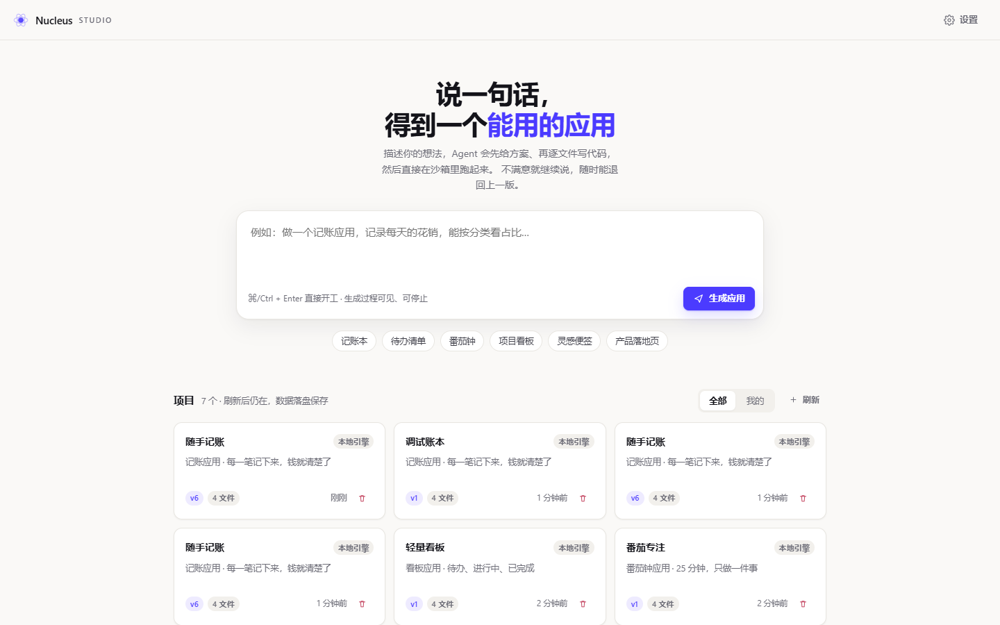
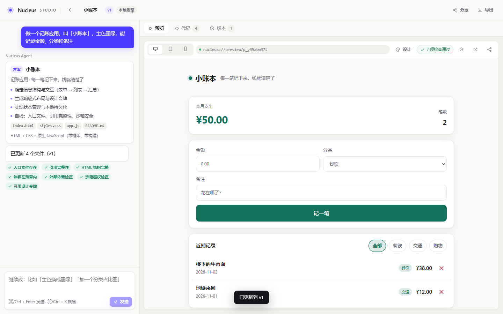

# 07 · 功能使用手册

> 面向**使用者的操作手册**：怎么用、每个按钮干什么、遇到问题怎么办。
> 想了解实现怎么做的，看 [08-完整技术文档](08-完整技术文档.md)；想看需求规格，看 [02-产品需求文档-PRD](02-产品需求文档-PRD.md)。

---

## 0. 30 秒上手

1. 打开首页 → 在输入框里写一句需求（或点一个「灵感」标签）；
2. 回车 → 自动跳到工作台，左边开始流式产出方案与代码，右边出现能点��应用；
3. 在应用里点两下，确认它是活的；
4. 不满意就在左下角继续说，比如「主色换成墨绿」；
5. 满意了点右上角「导出」，解压后双击 `index.html` 就能带走。

**不需要注册、不需要填 Key、不需要连数据库。**

---

## 1. 界面地图

```
/                 首页     —— 输入需求、查看我的项目
/studio/:id       工作台   —— 对话 + 预览 + 代码 + 版本
/p/:slug          分享页   —— 只读运行一个已生成的应用
/settings         设置     —— 切换引擎、配置模型、调整设计偏好
```

一个项目 = 一个应用 = 一个 `index.html` + 若干 CSS/JS 文件 + 一串版本快照。

---

## 2. 首页



### 2.1 输入区

| 元素 | 说明 |
| --- | --- |
| 文本框 | 写你的需求。`⌘/Ctrl + Enter` 直接开工 |
| 「生成应用」按钮 | 同上；生成中会变成转圈 |
| 灵感标签（6 个） | 记账本 / 待办清单 / 番茄钟 / 项目看板 / 灵感便签 / 产品落地页。点一下只是**填入**输入框，改完再发 |

**写需求的建议**（直接决定生成质量）：

| 想得到 | 这样写 |
| --- | --- |
| 特定名字 | 「做一个记账应用，叫「小账本」」 |
| 换应用类型 | 「改成待办清单」—— 只有明确点名才会换 |
| 特定配色 | 「主色用墨绿」/「深色风格」 |
| 特定字段 | 「记录金额、分类和备注」 |
| 特定货币 | 「金额用美元」 |
| 示例数据 | 「带几条示例数据」 |

上限 2000 字；超了会提示。**空内容不会发请求**。

### 2.2 项目列表

| 元素 | 说明 |
| --- | --- |
| 「全部 / 我的」 | 「我的」只显示**当前浏览器**创建的项目（靠本地访客标识识别，不是账号） |
| 刷新 | 强制重新拉取列表（列表默认缓存 30 秒） |
| 卡片 | 显示名称、简介、引擎、版本号、文件数、最后更新时间；点卡片进工作台 |
| 「我创建的」徽章 | 只在你自己的项目上出现 |
| 垃圾桶 | 删除项目（连同它的版本与对话一起删，**不可恢复**） |

> 首页自带 3 个示例项目（Nucleus 预生成），所以第一次打开不会是空白页。

---

## 3. 工作台



工作台分左右两栏：**左边是对话与过程，右边是产物**。

### 3.1 顶栏

| 元素 | 说明 |
| --- | --- |
| 返回箭头 | 回首页 |
| 项目名 | 点一下可以重命名（回车保存，Esc 取消） |
| `v3` 徽章 | 当前版本号 |
| 引擎徽章 | 「本地引擎」或「云模型」，**全程可见**，不会偷偷切换 |
| 分享 | 复制免登录分享链接 |
| 导出 | 下载 ZIP |

### 3.2 左栏 · 对话与过程

生成过程中，你会依次看到：

| 顺序 | 看到的东西 | 含义 |
| --- | --- | --- |
| 1 | 阶段药丸「正在拆解需求」 | Agent 在理解你的需求 |
| 2 | **方案卡** | 应用名、一句话简介、技术栈、步骤清单、文件清单 —— 这是「任务简报」，先于任何代码出现 |
| 3 | 阶段药丸「正在写代码」+ 文件流 | 每写一个文件就多一行，显示**真实路径**与**真实行数**，当前文件带转圈 |
| 4 | 阶段药丸「正在静态自检」+ 检查徽章 | 入口文件存在 / 引用完整性 / HTML 结构 / 体积 / 外部依赖 / 沙箱安全 |
| 5 | 「已更新 N 个文件（v2）」 | 本轮结束 |

其它交互：

- **停止**：生成中按钮变成「停止（保留已完成文件）」。点了之后，**已经写完的文件会保留下来**并落成一个新版本（版本标签是「中断保留」）；写了一半的文件回退到上一版。如果这次一个文件都没写完，**不会产生新版本**，界面会明确告诉你。
- **⌘/Ctrl + Enter**：发送。
- **Esc**：等同于点「停止」。
- **⌘/Ctrl + K**：把焦点拉回输入框。

### 3.3 右栏 · 三个视图

顶上有三个页签：

#### 「预览」

| 元素 | 说明 |
| --- | --- |
| 桌面 / 平板 / 手机 | 切换预览视口宽度（100% / 768 / 390） |
| 健康度指示灯 | 常驻显示静态自检结论（`7 项检查通过` / `2 项提醒` / `1 项阻断`），**点开看每一项的详情** |
| 设计 | 展开微调面板：改主色 / 圆角，**当场生效、不重新生成**（见 3.4） |
| 重新加载预览 | 重新挂载 iframe（不清数据） |
| 在新窗口打开 | 用 Blob URL 在新标签页打开当前产物 |
| 复制分享链接 | 同顶栏「分享」 |
| 运行时错误浮条 | 应用内部报错时出现在顶部，点「让 Agent 修复」自动把错误信息回灌给 Agent |

**沙箱说明**：预览跑在一个 `sandbox="allow-scripts allow-forms allow-modals allow-popups allow-downloads"` 的 iframe 里，**故意不给同源权限**。因此：

- 生成的应用里 `localStorage` 不可用 → 平台注入了内存版替身，并把写入同步回宿主；
- 结果是：**刷新预览，刚才记的账还在**；但应用读不到宿主页面的任何数据；
- 应用也不能访问父窗口、cookie 或本站接口。

#### 「代码」

- 左侧文件树（按路径排序），点击切换；
- 右侧显示当前文件：路径、行数、体积、复制按钮；
- 语法高亮（HTML / CSS / JS / JSON），自研，零依赖；
- 生成过程中，当前正在写的文件会自动高亮跟随。

#### 「版本」

每次生成、每次回滚都会留下一个**不可变快照**：

| 元素 | 说明 |
| --- | --- |
| `v1` `v2` … | 版本号 |
| 标签 | 「初始版本」/「第 N 版 · 你的需求摘要」/「回滚至 vN」/「中断保留 · N 个文件有变化」 |
| 「中断」徽章 | 这个版本来自一次手动停止 |
| 元信息 | 时间、文件数、变更文件数、`+行 / −行` |
| 变更文件标签 | 这一版改了哪些文件（新增/删除会标出来） |
| 回滚按钮 | 把项目恢复到该版本 —— **回滚本身也会生成一个新版本**，历史永不丢 |

---

### 3.4 设计微调面板

点工具栏的「设计」展开（再点收起）：

| 元素 | 说明 |
| --- | --- |
| 6 个色卡 | 墨绿 / 靛蓝 / 玫红 / 琥珀 / 石墨 / 天青，点一下**立刻换色** |
| 取色器 | 最右侧圆形色块，点开选任意颜色 |
| 圆角滑杆 | 0–28px；拖动时实时预览，松手 400ms 后自动保存 |
| 恢复默认 | 清除微调，回到生成时的外观 |
| 保存中… | 正在写入服务端（通常一闪而过） |
| 「只能调圆角」提示 | 该应用没声明设计令牌时出现（见下） |

三条要知道的行为：

1. **不重载页面**：改色是往沙箱里写 CSS 变量，你填了一半的表单、列表滚动位置都不会丢；
2. **随项目保存**：刷新、换设备、分享链接、导出 ZIP，看到的都是调过的配色；
3. **边界**：微调只覆盖 `--accent` / `--accent-soft` / `--accent-ink` / `--radius`。如果自检里「可用设计令牌」是红的（应用把颜色写死了），面板会提示只能调圆角——这时候请用对话让 Agent 改。

> 什么时候用面板、什么时候用对话：**你心里已经有确切颜色/圆角** → 面板（毫秒级、可回退）；**你要的是"更高级一点"这种意图** → 对话（模型负责判断怎么改）。


---

## 4. 典型剧本

### 剧本 A · 从零做一个应用

```
首页 → 输入「做一个记账应用，叫「小账本」，主色用墨绿，记录金额、分类和备注」
     → 生成应用
工作台 → 等方案卡出现（先看需求被理解成什么样）
       → 看文件一个个写完
       → 预览里点「记一笔」，填金额，回车
       → 点「重新加载预览」，数据还在 ✓
```

### 剧本 B0 · 只想换个颜色（最快路径）

```
预览工具栏 → 点「设计」→ 点一个色卡 → 拖一下圆角
          → 应用当场变色（不重新生成、不刷新）
刷新整页    → 配色还是新的 ✓
```

### 剧本 B · 改样式（只改该改的）

```
左下角输入框 → 「主色换成墨绿」
             → 右侧预览的主色立刻变了
版本页签 → 只有 styles.css 出现在「变更文件」里
```

> 应用**类型不会被改掉**：只要你的新指令没有点名要换类型（"改成待办"这种），它就还是原来那个应用。
> 例外：本地引擎是"槽位编译器"，它理解的是名称 / 配色 / 字段 / 货币这类可枚举的槽位；
> 「加一个番茄钟计时」这类开放域需求需要切到云模型才能真正实现。

### 剧本 C · 加功能

```
输入 → 「加一个分类占比条，用纯 CSS 实现」
     → 预览里出现占比条
```

### 剧本 D · 修一个自己制造的错误

```
在预览里打开控制台执行 undefinedFn()
     → 顶部立刻出现红色浮条「检测到 1 个运行时错误」
点「让 Agent 修复」
     → Agent 收到错误信息与堆栈，改完重写
     → 浮条消失
```

### 剧本 E · 回到上一版

```
版本页签 → 找到 v1 → 点「回滚」
        → 预览回到初版
        → 此时版本列表里多了一个 v3「回滚至 v1」（历史没有被销毁）
```

### 剧本 F · 带走产物

```
顶栏「导出」→ 下载 xxx.zip
     → 解压 → 双击 index.html
     → 浏览器直接打开就能用（不依赖任何服务）
```

### 剧本 G · 分享给朋友

```
顶栏「分享」→ 复制链接
     → 朋友打开就是应用本体，顶部一条工具条（作者 / 引擎 / 在 Studio 中打开 / 导出）
     → 无需注册、无需登录
```

### 剧本 H · 生成中途反悔了

```
生成到一半 → 点「停止（保留已完成文件）」
       → 已经写完的文件保留下来，版本 +1，标签是「中断保留」，带一个「中断」徽章
       → 写了一半的文件回退到上一版，不会留下半个坏文件
       → 如果刚好一个文件都没写完，则不产生新版本，界面会说明原因
```

---

## 5. 快捷键

| 快捷键 | 位置 | 作用 |
| --- | --- | --- |
| `⌘/Ctrl + Enter` | 首页 / 工作台 | 发送需求 |
| `⌘/Ctrl + K` | 首页 / 工作台 | 聚焦输入框 |
| `Esc` | 工作台 | 停止当前生成（等同点「停止」） |
| `Tab` | 全局 | 在可交互元素间移动焦点 |
| `Enter` | 项目卡片 | 打开项目 |
| `Esc` | 重命名输入框 | 取消重命名 |

---

## 6. 设置页

### 6.1 生成引擎

| 选项 | 说明 |
| --- | --- |
| **本地引擎**（默认） | 确定性的应用编译器：离线可用、零配置、结果可复现。覆盖 7 类常见应用（记账 / 待办 / 笔记 / 番茄钟 / 看板 / 计算器 / 落地页），并按你的描述抽取名称、配色、字段、货币等槽位 |
| **云模型** | 走任意 OpenAI 兼容接口（`{baseUrl}/chat/completions`，需支持 SSE 流式）。能力上限更高，但要先配好地址、模型名和 Key |

> 切换引擎**不会**影响已生成的项目。每个项目记住自己是用哪个引擎生成的（顶栏徽章可见）。

### 6.2 云模型配置

| 字段 | 说明 |
| --- | --- |
| 模型地址 | 完整地址，例如 `https://api.deepseek.com/v1`。**不允许指向内网或本机地址**（安全策略） |
| 模型名 | 例如 `deepseek-chat`、`gpt-4o-mini`、`qwen-plus` |
| API Key | 只存在服务端，接口只回显 `sk-****abcd`；留空表示不修改 |
| 「测试连接」 | 发一条最短请求，返回「连通正常 · 123ms · 模型名」，或明确失败原因 |

### 6.3 设计偏好

| 字段 | 说明 |
| --- | --- |
| 主色（6 个预设） | 注入到生成物的设计令牌。**在需求里明确写「主色用墨绿」会覆盖这里的设置** |
| 主题 | 浅色 / 深色 / 跟随系统 |
| 界面语言 | 简体中文 / English —— 生成的应用界面文案随之切换 |

改完点「保存设置」生效。

---

## 7. 错误处置手册

界面上每个错误都会给出：**发生了什么 · 为什么 · 现在点哪里**。

| 看到的标题 | 真实原因 | 怎么办 |
| --- | --- | --- |
| 模型拒绝了这个请求 | Key 填错、过期或没有该模型权限 | 点「去设置检查 Key」，确认后重试 |
| 额度或速率限制 | 余额不足或触发上游限流 | 等一会儿重试，或换个模型 |
| 模型响应超时 | 30s 无首字节，或传输中断 | 重试；或改用本地引擎 |
| 连不上模型服务 | 网络不通或地址不可达 | 检查地址；注意内网地址会被拒绝 |
| 模型没有按协议输出 | 模型没按格式返回文件 | 换个说法重试，或切本地引擎 |
| 云模型还没配置 | 缺地址 / 模型名 / Key | 点「去设置」 |
| 这个项目正在生成 | 同一项目同时只允许一个生成任务 | 等它跑完，或点「停止」 |
| 项目不存在 | 被删了或链接拼错 | 回首页 |
| 请求参数不合法 | 输入为空或超过 2000 字 | 改一下再发 |
| 服务端出了点问题 | 服务端异常 | 重试；反复失败就换个说法 |

**运行时错误**（生成的应用内部报错）是另一类：它不走错误卡，而是走预览顶部的浮条 → 点「让 Agent 修复」。

---

## 8. FAQ

**Q：生成的应用为什么是 HTML/CSS/JS，不是 React？**
A：为了让产物「挂载即跑」且「解压双击就能开」。Babel/构建链会让预览变慢、让离线不可用。

**Q：为什么刷新页面后，生成的应用里的数据还在？**
A：沙箱不给同源权限，所以注入了内存版 storage 并把写入同步回宿主，宿主再挂载时回灌。

**Q：我在设置里切了云模型，为什么首页的灵感标签还是老样子？**
A：灵感标签只是**示例文案**，生成时才会走你选的引擎。

**Q：一次生成会产生几个版本？**
A：一次。停止并保留也是一次（标记为「中断保留」）。回滚也是一次（标记为「回滚至 vN」）。

**Q：版本能删吗？**
A：不能删，这是设计取舍：**历史不可变**。单项目最多保留 30 个版本（保留首版 + 最近 5 版 + 其余按序裁剪），超出自动清理最旧的。

**Q：为什么项目是公开的？**
A：题面要求「无需注册」。这是明确的取舍：项目公开可读，写操作不做身份隔离。`createdBy` 只用于在界面上标出「我创建的」，**不是安全边界**。

**Q：我的数据存在哪？**
A：项目、版本、对话存在服务端 `data/db.json`（单文件，可直接删除重置）；生成的应用里的数据存在**你自己浏览器**的 localStorage 里。

**Q：支持多页面吗？**
A：当前不支持，生成物是单页应用。多页面在路线图里（P1）。

---

## 9. 用户视角的能力边界

| 能 | 不能 |
| --- | --- |
| 生成单页静态应用（HTML/CSS/JS） | 生成带后端、数据库、登录的应用 |
| 生成原生 JS 交互、localStorage 持久化 | 生成需要 npm 依赖的框架项目（目前只允许 CDN 外链） |
| 多轮对话迭代、增量修改 | 多页面路由 |
| 沙箱内真实运行与交互 | 让生成物部署到独立域名 |
| 版本回滚、文件级 diff | 多人实时协作 |
| 导出 ZIP、免登录分享 | 账号体系、权限管理 |
| 7 类常见应用的本地编译 | 开放域需求（需要切云模型） |

---

## 10. 相关文档

| 我想知道 | 看 |
| --- | --- |
| 每个功能的规格与验收标准 | [02-产品需求文档-PRD](02-产品需求文档-PRD.md) |
| 实现是怎么做的 | [08-完整技术文档](08-完整技术文档.md) |
| 为什么这么选 | [03-技术架构文档](03-技术架构文档.md) · [06-交付说明](06-交付说明.md) |
| 遇到了 bug 怎么排查 | [08-完整技术文档 §13 排障手册](08-完整技术文档.md) |
| 测试覆盖了什么 | [05-测试用例](05-测试用例.md) |
