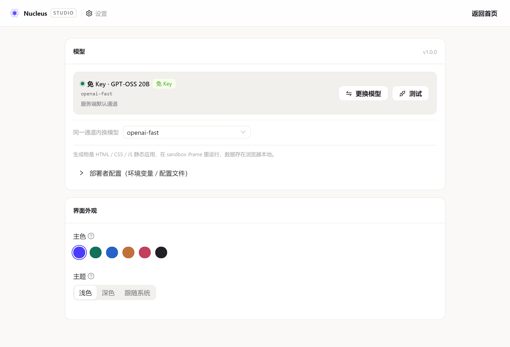
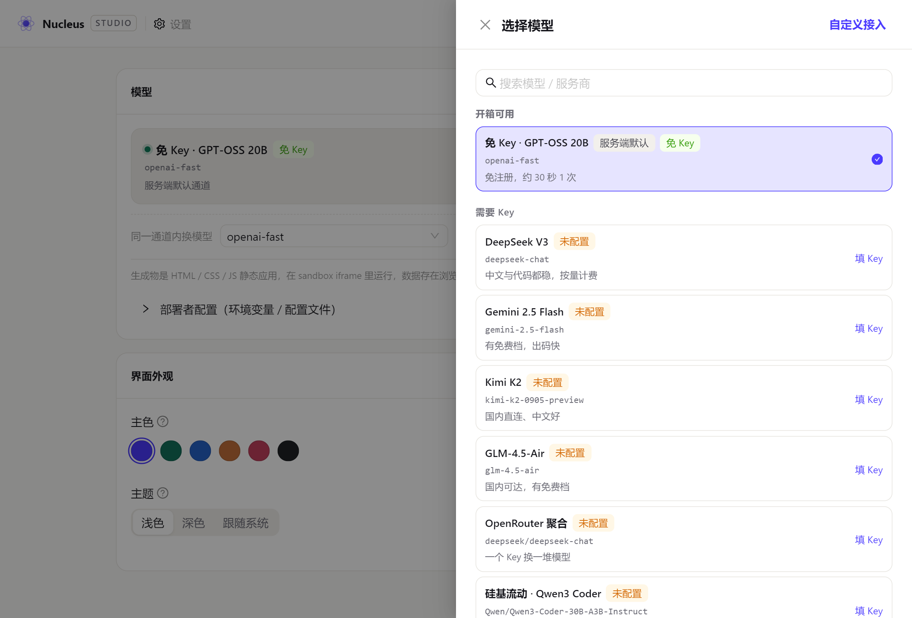

# 07 · 功能使用手册

> 面向**使用者的操作手册**：怎么用、每个按钮干什么、遇到问题怎么办。
> 想了解实现怎么做的，看 [08-完整技术文档](08-完整技术文档.md)；想看需求规格，看 [02-产品需求文档-PRD](02-产品需求文档-PRD.md)。

---

## 0. 30 秒上手

1. 打开首页 → 在输入框里写一句需求（或点一个「灵感」标签）；
2. 回车 → 自动跳到工作台，左边开始流式产出方案与代码，右边出现能点的应用；
3. 在应用里点两下，确认它是活的；
4. 不满意就在左下角继续说，比如「主色换成墨绿」；
5. 满意了点右上角「导出」，解压后双击 `index.html` 就能带走。

**代码由真实大模型生成**，默认走服务端的免 Key 通道：不需要注册、不需要填 Key、不需要连数据库。想更快或换口味，可以在设置里点名一个预设，或填你自己的 Key。

---

## 1. 界面地图

```
/                 首页     —— 输入需求、查看我的项目
/studio/:id       工作台   —— 对话 + 预览 + 代码 + 版本
/p/:slug          分享页   —— 只读运行一个已生成的应用
/settings         设置     —— 选择模型、接自己的模型、调整设计偏好
```

一个项目 = 一个应用 = 一个 `index.html` + 若干 CSS/JS 文件 + 一串版本快照。

---

## 2. 首页


### 2.1 输入区

| 元素 | 说明 |
| --- | --- |
| 文本框 | 写你的需求。`⌘/Ctrl + Enter` 直接开工 |
| 「生成应用」按钮 | 同上；生成中会变成转圈 |
| 灵感标签（6 个） | 记账本 / 待办清单 / 番茄钟 / 项目看板 / 灵感便签 / 产品落地页。点一下只是**填入**输入框，改完再发 |

首页顶部明示：**代码由真实大模型生成，默认走免 Key 通道，无需注册**。

**写需求的建议**（直接决定生成质量）：

| 想得到 | 这样写 |
| --- | --- |
| 特定名字 | 「做一个记账应用，叫「小账本」」 |
| 换应用类型 | 「改成待办清单」—— 只有明确点名才会换 |
| 特定配色 | 「主色用墨绿」/「深色风格」 |
| 特定字段 | 「记录金额、分类和备注」 |
| 示例数据 | 「带几条示例数据」 |

上限 2000 字；超了会提示。**空内容不会发请求**。

### 2.2 项目列表

| 元素 | 说明 |
| --- | --- |
| 「全部 / 我的」 | 「我的」只显示**当前浏览器**创建的项目（靠本地访客标识识别，不是账号） |
| 刷新 | 强制重新拉取列表（列表默认缓存 30 秒） |
| 卡片 | 显示名称、简介、模型出处、版本号、文件数、最后更新时间；点卡片进工作台 |
| 模型徽章 | 卡片上的灰色徽章显示该项目最近一次是**哪家模型**生成的（如「免 Key · GPT-OSS 20B」），不再是旧的引擎二选一徽章 |
| 「我创建的」徽章 | 只在你自己的项目上出现 |
| 垃圾桶 | 删除项目（连同它的版本与对话一起删，**不可恢复**；会弹二次确认，点「删除」才真的删，点「取消」或按 Esc 退出） |

> 首页自带 1 个出厂示例（由真实模型跑完整链路产出后固化入库，可追溯、可复现），所以第一次打开不会是空白页。

---

## 3. 工作台


工作台分左右两栏：**左边是对话与过程，右边是产物**。

### 3.1 顶栏

| 元素 | 说明 |
| --- | --- |
| 返回箭头 | 回首页 |
| 项目名 | 点一下可以重命名（回车保存，Esc 取消） |
| `v3` 徽章 | 当前版本号 |
| 模型徽章 | 显示该项目最近一次生成用的**模型出处**（如「免 Key · GPT-OSS 20B」「DeepSeek V3」），**全程可见** |
| 分享 | 复制免登录分享链接 |
| 导出 | 下载 ZIP |

### 3.2 左栏 · 对话与过程

生成过程中，你会依次看到：

| 顺序 | 看到的东西 | 含义 |
| --- | --- | --- |
| 1 | 阶段药丸「正在拆解需求」 | Agent 在理解你的需求 |
| 2 | **方案卡** | 应用名、一句话简介、技术栈、步骤清单、文件清单 —— 这是「任务简报」，先于任何代码出现 |
| 3 | 阶段药丸「正在写代码」+ 文件流 | 每写一个文件就多一行，显示**真实路径**与**真实行数**，当前文件带转圈 |
| 4 | 提示条（可选） | 排队、换模型、修复轮的过程性提示：灰条是 info，红条是 warn，**不是错误、不进版本历史** |
| 5 | 阶段药丸「正在静态自检」+ 检查徽章 | 入口 / 引用完整性 / 结构 / 体积 / 外链 / 沙箱安全 / 设计令牌，外加**每个 .js 一条语法检查** |
| 6 | 「已更新 N 个文件（v2）」 | 本轮结束 |

其它交互：

- **停止**：生成中按钮变成「停止（保留已完成文件）」。点了之后，**已经写完的文件会保留下来**并落成一个新版本（版本标签是「中断保留」）；写了一半的文件回退到上一版。如果这次一个文件都没写完，**不会产生新版本**，界面会明确告诉你。
- **⌘/Ctrl + Enter**：发送。
- **Esc**：等同于点「停止」。
- **⌘/Ctrl + K**：把焦点拉回输入框。

> 因为真实模型一轮常常要几十秒（免 Key 通道还要排队），生成明显比"本地模板"时代慢，这是**正常的**，见 §7 末尾"正常现象"。

### 3.3 右栏 · 三个视图

顶上有三个页签：

#### 「预览」

| 元素 | 说明 |
| --- | --- |
| 桌面 / 平板 / 手机 | 切换预览视口宽度（100% / 768 / 390） |
| 健康度指示灯 | 常驻显示静态自检结论（`N 项检查通过` / `N 项提醒` / `N 项阻断`），**点开看每一项的详情**；脚本语法不通会作为阻断项显示 |
| 设计 | 展开微调面板：改主色 / 圆角，**当场生效、不重新生成**（见 3.4） |
| 重新加载预览 | 重新挂载 iframe（不清数据） |
| 在新窗口打开 | 用 Blob URL 在新标签页打开当前产物 |
| 复制分享链接 | 同顶栏「分享」 |
| 运行时错误浮条 | 应用内部报错时出现在顶部，点「让 Agent 修复」自动把错误信息回灌给 Agent |

**沙箱说明**：预览跑在一个 `sandbox="allow-scripts allow-forms allow-modals allow-popups allow-downloads"` 的 iframe 里，**故意不给同源权限**。因此：

- 生成的应用里 `localStorage` 不可用 → 平台注入了内存版替身，并把写入同步回宿主；
- 结果是：**刷新预览，刚才记的账还在**；但应用读不到宿主页面的任何数据；
- 应用也不能访问父窗口、cookie 或本站接口。

#### 「代码」

- 左侧文件树（按路径排序），点击切换；
- 右侧显示当前文件：路径、行数、体积、复制按钮；
- 语法高亮（HTML / CSS / JS / JSON），自研，零依赖；
- 生成过程中，当前正在写的文件会自动高亮跟随。

#### 「版本」

每次生成、每次回滚都会留下一个**不可变快照**：

| 元素 | 说明 |
| --- | --- |
| `v1` `v2` … | 版本号 |
| 标签 | 「初始版本」/「第 N 版 · 你的需求摘要」/「回滚至 vN」/「中断保留 · N 个文件有变化」 |
| 「中断」徽章 | 这个版本来自一次手动停止 |
| 元信息 | 时间、文件数、变更文件数、`+行 / −行` |
| 变更文件标签 | 这一版改了哪些文件（新增/删除会标出来） |
| 回滚按钮 | 把项目恢复到该版本 —— **回滚本身也会生成一个新版本**，历史永不丢 |

---

### 3.4 设计微调面板

点工具栏的「设计」展开（再点收起）：

| 元素 | 说明 |
| --- | --- |
| 6 个色卡 | 墨绿 / 靛蓝 / 玫红 / 琥珀 / 石墨 / 天青，点一下**立刻换色** |
| 取色器 | 最右侧圆形色块，点开选任意颜色 |
| 圆角滑杆 | 0–28px；拖动时实时预览，松手 400ms 后自动保存 |
| 恢复默认 | 清除微调，回到生成时的外观 |
| 保存中… | 正在写入服务端（通常一闪而过） |
| 「只能调圆角」提示 | 该应用没声明主色令牌 `--accent` 时出现（见下） |

三条要知道的行为：

1. **不重载页面**：改色是往沙箱里写 CSS 变量，你填了一半的表单、列表滚动位置都不会丢；
2. **随项目保存**：刷新、换设备、分享链接、导出 ZIP，看到的都是调过的配色；
3. **边界**：微调只覆盖 `--accent` / `--accent-soft` / `--accent-ink` / `--radius`。生成时提示词已要求模型把主色写成 `--accent`、圆角写成 `--radius` 并定义在 `:root`；如果某个应用把颜色写死了，自检「可用设计令牌」会提示主色需要重新生成，此时请用对话让 Agent 改。

> 什么时候用面板、什么时候用对话：**你心里已经有确切颜色/圆角** → 面板（毫秒级、可回退）；**你要的是"更高级一点"这种意图** → 对话（模型负责判断怎么改）。


---

## 4. 典型剧本

### 剧本 A · 从零做一个应用

```
首页 → 输入「做一个记账应用，叫「小账本」，主色用墨绿，记录金额、分类和备注」
     → 生成应用
工作台 → 等方案卡出现（先看需求被理解成什么样）
       → 看文件一个个写完（可能要排队、要等一会儿）
       → 在应用里试一次它的主要操作（记一笔 / 加一条 / 勾一项）
       → 点「重新加载预览」，刚才的数据还在 ✓
```

> 生成物由模型产出，具体按钮文案不固定；只要**录进去的东西刷新后还在**，就说明交互与持久化都是真的。

### 剧本 B0 · 只想换个颜色（最快路径）

```
预览工具栏 → 点「设计」→ 点一个色卡 → 拖一下圆角
          → 应用当场变色（不重新生成、不刷新）
刷新整页    → 配色还是新的 ✓
```

### 剧本 B · 改样式（只改该改的）

```
左下角输入框 → 「主色换成墨绿」
             → 右侧预览的主色变了
版本页签 → 会列出本次变更的文件（通常主要是 styles.css）
```

> 应用**类型不会被改掉**：只要你的新指令没有点名要换类型（"改成待办"这种），它就还是原来那个应用。
> 模型一次生成得不完全对也没关系：如果缺了被引用的文件、或有脚本没写完，系统会自动补一轮；你也可以继续用对话让它接着改。

### 剧本 C · 加功能

```
输入 → 「加一个分类占比条，用纯 CSS 实现」
     → 预览里出现占比条
```

### 剧本 D · 修一个自己制造的错误

```
在预览里打开控制台，手动抛一个错误
     → 顶部立刻出现红色浮条「检测到运行时错误」
点「让 Agent 修复」
     → Agent 收到错误信息与堆栈，改完重写
     → 浮条消失
```

### 剧本 E · 回到上一版

```
版本页签 → 找到 v1 → 点「回滚」
        → 预览回到初版
        → 此时版本列表里多了一个 v3「回滚至 v1」（历史没有被销毁）
```

### 剧本 F · 带走产物

```
顶栏「导出」→ 下载 xxx.zip
     → 解压 → 双击 index.html
     → 浏览器直接打开就能用（产物不依赖任何服务，可离线运行）
```

### 剧本 G · 分享给朋友

```
顶栏「分享」→ 复制链接
     → 朋友打开就是应用本体，顶部一条工具条（作者 / 模型出处 / 在 Studio 中打开 / 导出）
     → 无需注册、无需登录
```

### 剧本 H · 生成中途反悔了

```
生成到一半 → 点「停止（保留已完成文件）」
       → 已经写完的文件保留下来，版本 +1，标签是「中断保留」，带一个「中断」徽章
       → 写了一半的文件回退到上一版，不会留下半个坏文件
       → 如果刚好一个文件都没写完，则不产生新版本，界面会说明原因
```

---

## 5. 快捷键

| 快捷键 | 位置 | 作用 |
| --- | --- | --- |
| `⌘/Ctrl + Enter` | 首页 / 工作台 | 发送需求 |
| `⌘/Ctrl + K` | 首页 / 工作台 | 聚焦输入框 |
| `Esc` | 工作台 | 停止当前生成（等同点「停止」） |
| `Tab` | 全局 | 在可交互元素间移动焦点 |
| `Enter` | 项目卡片 | 打开项目 |
| `Esc` | 重命名输入框 | 取消重命名 |

---

## 6. 设置页

设置页的核心是**用哪个模型**：所有生成都交给真实大模型，没有本地模板兜底。默认走服务端的免 Key 通道，打开即用；也可以点名一个预设，或接自己的服务商。



### 6.1 当前模型

「模型」卡片只回答一个问题：现在打给谁。

- 左边是通道名、徽标（**免 Key** / **自带 Key** / **服务端**）、具体模型名，以及一句「为什么是它」——`服务端默认通道` / `按你的选择使用「X」` / `「X」还没有 Key，已回退到 Y` / `使用你自带的 Key`；
- 右边两个动作：**更换模型**（开抽屉）、**测试**（对当前生效通道发一条最短请求，返回延迟）；
- 同一家有多档模型时（OpenRouter 聚合、DeepSeek chat/reasoner、Gemini flash/pro…），卡片下方多一行「**同一通道内换模型**」，选完立刻生效，不用改配置文件；
- 目录有问题时（`config/providers.json` 写坏、条目缺 `baseUrl`/`model` 被跳过、`default` 指向不存在的 id、内联环境变量地址非法），卡片下方直接列出**警告**，不再静默忽略；
- **改了就是生效**：这一版没有「保存设置」按钮，选完立刻写回服务端；外观同理。

### 6.2 更换模型（抽屉）

点「更换模型」打开抽屉，列表按可用性分三组，顶部可搜索（模型名、服务商名都能搜）：



| 分组 | 含义 | 点一下会怎样 |
| --- | --- | --- |
| **开箱可用** | 不需要任何 Key，平台已就绪（目前是免 Key 通道） | 立刻切过去 |
| **已配置** | 服务端已经配好 Key 的预设，或你之前填过 Key 的通道 | 立刻切过去 |
| **需要 Key** | 内置预设，但服务端没给 Key | 进「自定义接入」，地址与模型已按这一家预填，补 Key 即可 |

右上角「**自定义接入**」用于接列表里没有的服务商。未配置的行只提示「填 Key」，申请入口放在自定义表单里（走到那一步才需要）。

### 6.3 自定义接入

| 字段 | 说明 |
| --- | --- |
| 常用服务商（一排胶囊） | DeepSeek / OpenAI / Kimi / GLM / 硅基流动 / OpenRouter / Gemini。点一下自动填好 Base URL 与一个能跑的模型名，你只需要粘 Key |
| Base URL | 完整地址，例如 `https://api.deepseek.com/v1`。会拼成 `{baseUrl}/chat/completions`，必须支持 SSE 流式。**默认不允许内网或本机地址**（SSRF 防护），自建网关需服务端显式设 `NUCLEUS_ALLOW_LOCAL_LLM=1` |
| API Key | 只存在服务端，接口只回显掩码（如 `sk-****7890`），不进产物、不转发、不写日志。留空表示"不修改" |
| 模型 | 可以手填，也可以点「**拉取列表**」——直接问上游 `GET {baseUrl}/models`，自动过滤掉 embedding / whisper / 图像类模型。模型名拼错是自定义接入最高频的失败原因，所以这里优先让你选 |
| 高级参数 | 最大输出 tokens（256–32768，默认 8192）与温度（0–2，默认 0.4）。应用写到一半被截断时，先把输出上限调大 |

两个动作：

- **测试连接**：只测当前草稿，不落库；返回「连通正常 · 123ms · {模型回话}」或明确的失败原因。
- **保存并使用**：写回服务端并立刻切到这条通道；之后卡片上会标「自带 Key」。
- **清除已保存的 Key**：把服务端的 Key 清掉，通道回落。

> 三个字段必须齐全才算配置好：缺任何一项都会在保存前拦下，而不是悄悄回落到服务端通道。

### 6.4 界面外观

| 字段 | 说明 |
| --- | --- |
| 主色（6 个预设） | **立即**改变工作台的强调色；同时作为新生成应用的默认主色。在需求里明确写「主色用墨绿」会以需求为准 |
| 主题 | 浅色 / 深色 / 跟随系统。**立即**切换工作台的配色；新建应用也默认用这套外观（深色主题会作为设计参数告诉模型） |

外观偏好保存在**这台浏览器**上（换浏览器/清缓存会回到保存过的那一份），并且颜色与主题都会即时写进服务端设置，作为新建项目的默认设计参数。点色卡/切主题当场生效并立刻同步，没有「保存」按钮。

> 生成物的语言跟随你的需求描述（例如「界面用英文」）；设置页不再单独放一个语言开关，避免出现"切了没反应"的假开关。

---

## 7. 错误处置手册

界面上每个错误都会给出：**发生了什么 · 为什么 · 现在点哪里**。

| 看到的标题 | 真实原因 | 怎么办 |
| --- | --- | --- |
| 模型拒绝了这个请求 | Key 填错、过期或没有该模型权限 | 点「去设置检查 Key」，确认后重试 |
| 额度或速率限制 | 余额不足或触发上游限流（免 Key 通道约 30 秒 1 次） | 稍等重试，或在设置里换成你自己的 Key / 点别的预设 |
| 模型响应超时 | 30s 无首字节，或传输中断 | 重试；反复超时可在设置里换一家模型 |
| 连不上模型服务 | 网络不通或地址不可达 | 检查地址；注意内网地址会被拒绝 |
| 模型没有按协议输出 | 模型没按格式返回文件（可能太小或太爱解释） | 换个说法重试，或在设置里换一家 |
| 没有可用的模型通道 | 服务端把免 Key 通道关掉了，也没填自己的 Key | 点「去设置」选一个已就绪的预设，或填上你的 Key |
| 这个项目正在生成 | 同一项目同时只允许一个生成任务 | 等它跑完，或点「停止」 |
| 项目不存在 | 被删了或链接拼错 | 回首页 |
| 请求参数不合法 | 输入为空或超过 2000 字 | 改一下再发 |
| 服务端出了点问题 | 服务端异常 | 重试；反复失败就换个说法 |

**运行时错误**（生成的应用内部报错）是另一类：它不走错误卡，而是走预览顶部的浮条 → 点「让 Agent 修复」。

### 正常现象（不是错误，不用慌）

真实模型 + 免 Key 配额下，以下几条会经常发生：

| 现象（提示条） | 为什么会这样 | 处置 |
| --- | --- | --- |
| 生成很慢、转圈很久 | 一次真实生成常要几十秒，比模板时代慢很多 | 耐心等；想更快就换一家非免 Key 预设（填 Key） |
| 「…是免 Key 通道，前面还有约 N 秒排队，正在等它…」 | 匿名档配额约同一 IP 每 30 秒 1 次，多人同时点会排队 | 等排队过去即可；不想等就在设置里换一家或自带 Key |
| 「…这次不可用，正在换下一家（…）」（红条） | 这一家鉴权/额度/超时/网络出错，且本轮还没有产出，系统自动换下一家 | 通常随后就成功；反复换家可在设置里指定更稳的一家 |
| 「检测到 X 不完整，正在修第 1 轮…」 | 模型漏写了被引用的文件、或脚本写到一半被截断、语法不通，系统自动补一轮 | 等修复完成；最多修两轮 |
| 「修完仍有问题：…。已保留能用的部分，你可以继续对话让它补。」（红条） | 修了两轮还差一点，但为了不让你空手而归，保留了当前最好的产物 | 继续用对话让它补齐，或换个更具体的需求重试 |

> 注意：只有**整条链都没成功**时才会出现红色错误卡；换家与修复都是中间过程的提示，不会先红一条再成功。

---

## 8. FAQ

**Q：没有 Key 也能生成吗？**
A：能。默认走服务端的免 Key 通道，打开即用、无需注册。代价是它有配额（约同一 IP 每 30 秒 1 次），人多时会排队。

**Q：配额用完了 / 一直在排队怎么办？**
A：三个选择：（1）稍等一会儿再点；（2）在设置页点名一个已就绪的预设（如 DeepSeek / Gemini，需要服务端或你提供 Key）；（3）在「我的 Key」里填自己的 Key，走你自己的额度。

**Q：生成的应用为什么是 HTML/CSS/JS，不是 React？**
A：为了让产物「挂载即跑」且「解压双击就能开」。Babel/构建链会让预览变慢、让离线不可用。

**Q：为什么刷新页面后，生成的应用里的数据还在？**
A：沙箱不给同源权限，所以注入了内存版 storage 并把写入同步回宿主，宿主再挂载时回灌。

**Q：我在设置里选了别的模型，为什么首页的灵感标签还是老样子？**
A：灵感标签只是**示例文案**，生成时才会走你选的通道。

**Q：一次生成会产生几个版本？**
A：一次（含自动修复轮也只算一次落库）。停止并保留也是一次（标记为「中断保留」）。回滚也是一次（标记为「回滚至 vN」）。

**Q：版本能删吗？**
A：不能删，这是设计取舍：**历史不可变**。单项目最多保留 30 个版本（保留首版 + 最近 5 版 + 其余按序裁剪），超出自动清理最旧的。

**Q：为什么项目是公开的？**
A：题面要求「无需注册」。这是明确的取舍：项目公开可读，写操作不做身份隔离。`createdBy` 只用于在界面上标出「我创建的」，**不是安全边界**。

**Q：我的数据存在哪？**
A：项目、版本、对话存在服务端 `data/db.json`（单文件，可直接删除重置）；生成的应用里的数据存在**你自己浏览器**的 localStorage 里；你在设置里填的 Key 只存在服务端。

**Q：支持多页面吗？**
A：当前不支持，生成物是单页应用。多页面在路线图里（P1）。

---

## 9. 用户视角的能力边界

| 能 | 不能 |
| --- | --- |
| 用真实大模型生成单页静态应用（HTML/CSS/JS） | 生成带后端、数据库、登录的应用 |
| 生成原生 JS 交互、localStorage 持久化 | 生成需要 npm 依赖的框架项目（目前只允许 CDN 外链） |
| 多轮对话迭代、增量修改 | 多页面路由 |
| 沙箱内真实运行与交互 | 让生成物部署到独立域名 |
| 版本回滚、文件级 diff | 多人实时协作 |
| 导出 ZIP、免登录分享 | 账号体系、权限管理 |
| 免 Key 通道零配置生成（有配额） | 保证一次生成 100% 覆盖任意复杂开放域需求（可能需多轮对话或换更强模型） |

---

## 10. 相关文档

| 我想知道 | 看 |
| --- | --- |
| 每个功能的规格与验收标准 | [02-产品需求文档-PRD](02-产品需求文档-PRD.md) |
| 实现是怎么做的 | [08-完整技术文档](08-完整技术文档.md) |
| 为什么这么选 | [03-技术架构文档](03-技术架构文档.md) · [06-交付说明](06-交付说明.md) |
| 遇到了 bug 怎么排查 | [08-完整技术文档 §13 排障手册](08-完整技术文档.md) |
| 测试覆盖了什么 | [05-测试用例](05-测试用例.md) |
